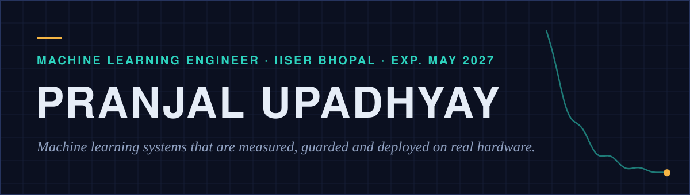
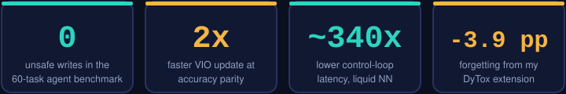
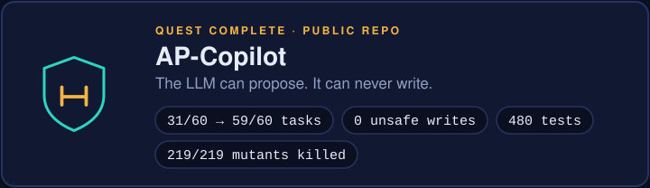

<a href="https://www.linkedin.com/in/pranjal-upadhyay7">LinkedIn</a> · <a href="#selected-work">Selected work</a> · <a href="#contact">Contact</a>

I build LLM agents with safety guardrails, deep-learning systems, and robotics that runs on real hardware (Jetson, drones). Two years in a robotics lab, TCS Research intern, BS-MS at IISER Bhopal (exp. May 2027), looking for full-time ML Engineer roles in India.

<h2 id="selected-work"></h2>

Code: <a href="https://github.com/PranjalUpadhyay7/Federated_Learning">Federated_Learning</a> · <a href="https://github.com/PranjalUpadhyay7/dytox_modification">dytox_modification</a> (built on <a href="https://github.com/arthurdouillard/dytox">DyTox</a> by Douillard et al.) · <a href="https://github.com/PranjalUpadhyay7/Detection_algo_benchmark">Detection_algo_benchmark</a> · <a href="https://github.com/PranjalUpadhyay7/DROID-SLAM-on-OAKD_pro-realtime">DROID-SLAM-on-OAKD_pro-realtime</a> · <a href="https://devpost.com/software/novalearn-ty2b3k">NovaLearn on DevPost</a>

<b>How these numbers were measured</b>

- AP-Copilot: my own 30-task benchmark, machine-checked against what a fake vehicle received (no LLM judge). "Unsafe write" means a value the project's own validator would reject. The 219 mutants cover the validation layer only.
- TCS results are simulation only. The NIDAR swarm is simulation-validated; the 8-drone mission is the planned target and has not flown. GNSS-denied flights were validated at 50 to 80 m. The OpenVINS C++ speed-up was a 3-person effort at accuracy parity.
- Detector benchmark: 11 public detectors, VisDrone2019-DET validation set (person class), mAP@0.5 0.487 for LEAF-YOLO-s vs 0.438 for YOLOv8x on a PC CPU. The Jetson Nano figure is end to end for LEAF-YOLO-s only.
- The Liquid NN result is from my own experiments; the paper is in preparation. Federated results are as reported in that repo; clients ran as Flower processes, not on phones.

<h2 id="experience"></h2>

<h2 id="skills"></h2>

ISRO Hackathon '24 and '25 and Google AI Builder Lab are certificates, not awards. NovaLearn was submitted to the Amazon Nova Hackathon 2025 (no win claimed). CodeChef max rating 1644 (3 star).

<h2 id="contact"></h2>

<a href="https://www.linkedin.com/in/pranjal-upadhyay7">linkedin.com/in/pranjal-upadhyay7</a>

