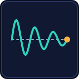
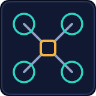

<a href="https://www.linkedin.com/in/pranjal-upadhyay7">LinkedIn</a> · <a href="#selected-work">Selected work</a> · <a href="#contact">Contact</a>

<h2 id="about"></h2>

I build LLM agents with safety guardrails, deep-learning systems, and models that run on edge hardware such as the Jetson. I am a BS-MS student at IISER Bhopal, and I am looking for full-time Machine Learning Engineer roles in India.

**Role:** Machine Learning Engineer · **Education:** IISER Bhopal, BS-MS, Major in Computer Science (EECS), Minor in Data Science, exp. May 2027 · **Looking for:** full-time ML Engineer roles in India · **Based in:** Bhopal, India

<h2 id="selected-work"></h2>

<table>
<tr>
<td width="110" valign="top"></td>
<td valign="top"><b>AP-Copilot</b> (Aug 2026 to present). A safety-critical LLM agent that configures ArduPilot/Pixhawk parameters from plain-language requests. The LLM assists; deterministic guardrails and a human-approval gate block unsafe or hallucinated changes. Firmware-version-aware hybrid RAG (BM25 + embeddings, fused with RRF) over indexed docs, the community wiki and verified web search. <code>20/30 -> 30/30 tasks</code> <code>0 unsafe writes</code> <code>219/219 mutants killed</code> <code>46.15 s -> 14.6 s latency</code> Python, FastAPI, LangGraph, pymavlink, React/TypeScript, Tauri/Rust. Public release soon.</td>
</tr>
<tr>
<td width="110" valign="top"></td>
<td valign="top"><b>Federated Mood Prediction for Early Depression Screening.</b> A Flower federated pipeline that predicts 5-class mood from passively collected smartphone behavioural signals (DiversityOne dataset, 8 countries). Each participant is a separate, non-IID client. Includes a cross-country domain-shift study and a cascading cold-start protocol. <code>TabM 69.95%</code> <code>LSTM 68.28%</code> <code>deep MLP 56.11%</code> <code>within 2% of centralized</code> <a href="https://github.com/PranjalUpadhyay7/Federated_Learning">Federated_Learning</a></td>
</tr>
<tr>
<td width="110" valign="top"></td>
<td valign="top"><b>NovaLearn</b> (Amazon Nova Hackathon 2025). A planner + executor multi-agent study companion, shipped as a Chrome extension. Four Amazon Nova models (Lite, Pro, Reel, Sonic) run through a custom AWS Bedrock layer; Whisper handles speech-to-text. <code>4 Nova models</code> <code>4-scene parallel pipeline</code> <code>24 s animation in about 4 min</code> React/TypeScript, FastAPI. <a href="https://devpost.com/software/novalearn-ty2b3k">DevPost</a></td>
</tr>
<tr>
<td width="110" valign="top"></td>
<td valign="top"><b>DyTox modification.</b> Two extensions to the DyTox continual-learning transformer, evaluated on CIFAR-100. The Task-Aware Encoder (TAE) reduced forgetting. Dynamic Contextual Positional Embeddings (DCPE) made results worse, traced to MLP overfitting and inter-task interference. <code>TAE forgetting 18.7% -> 14.8% (-3.9 pp)</code> <code>DCPE 70.3 -> 67.0 (10-task)</code> <code>DCPE 68.3 -> 65.1 (50-task)</code> <a href="https://github.com/PranjalUpadhyay7/dytox_modification">dytox_modification</a>, built on <a href="https://github.com/arthurdouillard/dytox">DyTox</a> by Douillard et al.</td>
</tr>
<tr>
<td width="110" valign="top"></td>
<td valign="top"><b>Liquid Neural Network Adaptive Controller.</b> Journal paper in preparation. A liquid-NN adaptive controller with online parameter updates on a non-blocking background thread, compared against a DNN + ODE-solver baseline. <code>about 340x lower control-loop latency</code> <code>about 19% lower tracking error</code></td>
</tr>
<tr>
<td width="110" valign="top"></td>
<td valign="top"><b>Applied Robotics: NIDAR 2.0</b> (team lead, 6 members). Building an 8-drone swarm that autonomously searches a disaster zone and delivers rescue packets over a custom communication network. That is the planned target; in simulation, 2 recon and 4 delivery drones covered 10 hectares in under 5 min. I benchmarked 11 public detectors on VisDrone (LEAF-YOLO-s, 4.28M params, beats YOLOv8x, 68.16M) and navigate without GNSS using MSCKF + EKF visual-inertial estimation on a Jetson Orin Nano 8 GB, flight-validated at 50 to 80 m. <code>mAP@0.5 0.487 vs 0.438 (LEAF-YOLO-s vs YOLOv8x)</code> <code>4.5 to 4.6 FPS on Jetson Nano, TensorRT FP16</code> <code>OpenVINS update 7.5 -> 3.7 to 4.0 ms</code> <code>mean ATE ratio 0.98</code> <a href="https://github.com/PranjalUpadhyay7/Detection_algo_benchmark">Detection_algo_benchmark</a> (detector benchmark; the swarm and VIO code are not public)</td>
</tr>
</table>

**Measurement notes.**
- AP-Copilot figures come from my own 30-task benchmark (checked by machine against what a fake vehicle received, no LLM judge). "Unsafe write" means a value the project's own validator would reject. The 219 mutants cover the validation layer only, not the whole codebase.
- TCS results are simulation only. The NIDAR swarm is simulation-validated; the full 8-drone mission is the planned target and has not flown. GNSS-denied flights were validated at 50 to 80 m. The OpenVINS speed-up was a 3-person effort at accuracy parity.
- The detector comparison is mAP@0.5 on the VisDrone2019-DET validation set (548 images, person class), run through that repo's own C++ pipeline on a PC CPU. The Jetson Nano (4 GB) FPS is end to end for LEAF-YOLO-s only; the other models were not measured on the device.
- The Liquid NN result is from my own experiments; the paper is in preparation. Federated results are as reported in that repo's evaluation notes; clients ran as Flower processes, not on phones.

<h2 id="experience"></h2>

**TCS Research & Innovation, Research Intern, AI and Robotics (May to Jul 2025).** A PyBullet simulation platform (4 warehouse scenarios) to train and validate an in-house soft gripper across 20 object categories; an RGB-D pipeline predicting 6-DoF grasp poses in clutter; a PPO grasping policy trained over a 48-hour simulation run, with 15 to 30 s per-object pick cycles. Simulation only.

**MOON Lab, IISER Bhopal, undergraduate researcher.** Perception, state estimation and adaptive control, advised by Dr. P. B. Sujit.

<h2 id="skills"></h2>

**Languages & Data:** Python, C++, TypeScript, Rust (Tauri) 
**ML & Deep Learning:** PyTorch, TabM, LSTM, transformers, continual learning, federated learning (Flower), reinforcement learning (PPO, PyBullet), object detection (YOLO family, LEAF-YOLO), visual-inertial estimation (MSCKF, EKF) 
**GenAI & NLP:** LangGraph, hybrid RAG (BM25, embeddings, RRF), LLM agent guardrails, AWS Bedrock (Amazon Nova), Whisper 
**Deployment:** FastAPI, TensorRT FP16, Jetson Nano and Orin Nano, ArduPilot/pymavlink, Chrome extensions, pytest and mutation testing

**Recognition:** ISRO Hackathon '24 and '25 and Google AI Builder Lab are certificates, not awards. NovaLearn was submitted to the Amazon Nova Hackathon 2025 (no win claimed). CodeChef max rating 1644 (3 star).

<h2 id="contact"></h2>

<a href="https://www.linkedin.com/in/pranjal-upadhyay7">linkedin.com/in/pranjal-upadhyay7</a>

