

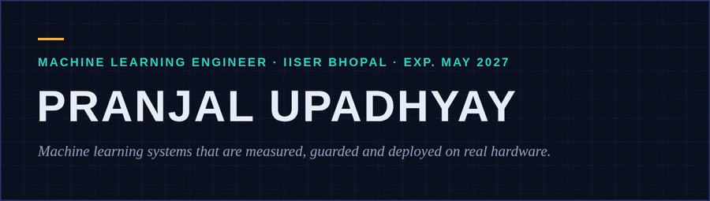

<a href="https://www.linkedin.com/in/pranjal-upadhyay7">LinkedIn</a> · <a href="#quests">Quest log</a> · <a href="#achievements">Achievements</a> · <a href="#contact">Contact</a>

<h2 id="quests"></h2>

 
<a href="https://github.com/PranjalUpadhyay7/Detection_algo_benchmark">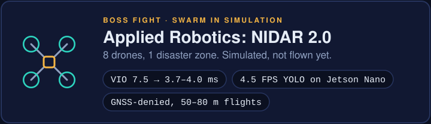</a> 
<a href="https://github.com/Shafwansafi06/vio_pipeline_cpp">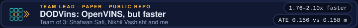</a> 
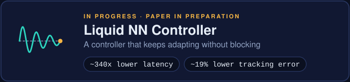 
<a href="https://github.com/PranjalUpadhyay7/dytox_modification">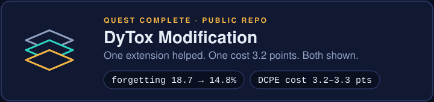</a> 
<a href="https://github.com/PranjalUpadhyay7/openvins-python-hovering-aware-msckf">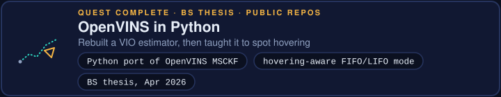</a> 
<a href="https://github.com/PranjalUpadhyay7/DROID-SLAM-on-OAKD_pro-realtime">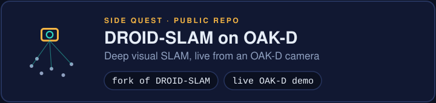</a> 
<a href="https://github.com/PranjalUpadhyay7/Federated_Learning">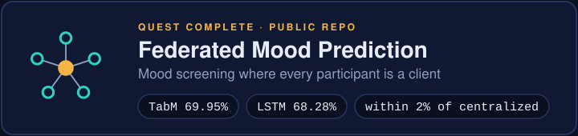</a> 
<a href="https://devpost.com/software/novalearn-ty2b3k">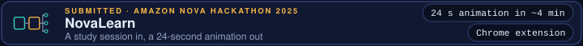</a>

<b>AP-Copilot: how a parameter change gets written</b>

The model can read, search and propose. It has no write tool. Every stage after the proposal is ordinary deterministic code.

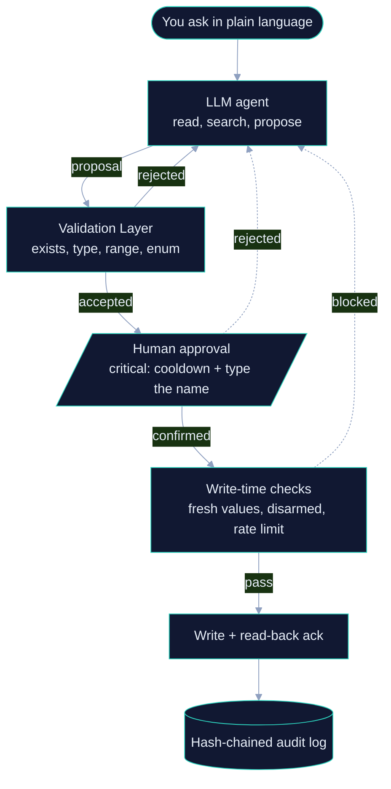

<b>All repos and links</b>

Code: <a href="https://github.com/PranjalUpadhyay7/AP-Copilot">AP-Copilot</a> · <a href="https://github.com/Shafwansafi06/vio_pipeline_cpp">vio_pipeline_cpp</a> (DODVins, with Shafwan Safi and Nikhil Vashisht) · <a href="https://github.com/PranjalUpadhyay7/openvins-python-msckf">openvins-python-msckf</a> · <a href="https://github.com/PranjalUpadhyay7/openvins-python-hovering-aware-msckf">openvins-python-hovering-aware-msckf</a> (thesis, GPL-3.0, derived from <a href="https://github.com/rpng/open_vins">OpenVINS</a>) · <a href="https://github.com/PranjalUpadhyay7/Federated_Learning">Federated_Learning</a> · <a href="https://github.com/PranjalUpadhyay7/dytox_modification">dytox_modification</a> (built on <a href="https://github.com/arthurdouillard/dytox">DyTox</a> by Douillard et al.) · <a href="https://github.com/PranjalUpadhyay7/Detection_algo_benchmark">Detection_algo_benchmark</a> · <a href="https://github.com/PranjalUpadhyay7/DROID-SLAM-on-OAKD_pro-realtime">DROID-SLAM-on-OAKD_pro-realtime</a> · <a href="https://devpost.com/software/novalearn-ty2b3k">NovaLearn on DevPost</a>

<b>How these numbers were measured</b>

- AP-Copilot: my own 60-task benchmark, machine-checked against what a fake vehicle received (no LLM judge). "Unsafe write" means a value the project's own validator would reject. 31/60 to 59/60 is one model (gpt-oss-20b), one repeat, with safety layers removed cumulatively; the 0 unsafe writes covers five models at 3 repeats on the full system. The 219 mutants cover the validation layer only. Free-tier models and author-written tasks: see the repo's caveats.
- OpenVINS in Python: a port that mirrors OpenVINS's structure and is GPL-3.0 as a derivative work; static initialisation only, ROS 1 required, a thesis artifact rather than a production estimator.
- TCS results are simulation only. The NIDAR swarm is simulation-validated; the 8-drone mission is the planned target and has not flown. GNSS-denied flights were validated at 50 to 80 m.
- DODVins: numbers from the team's paper (`paper/main.tex` in the repo; authors Shafwan Safi, Nikhil Vashisht, Pranjal Upadhyay). Ten public sequences (EuRoC, KAIST) run through the same transport and toolchain container as official OpenVINS: mean ATE 0.156 m vs 0.158 m (better on 4 of 10), 1.76 to 2.10x faster end to end. On a Jetson Orin Nano it is faster on all ten, with a narrower margin. Same filter equations as OpenVINS; the change is memory layout.
- Detector benchmark: 11 public detectors, VisDrone2019-DET validation set (person class), mAP@0.5 0.487 for LEAF-YOLO-s vs 0.438 for YOLOv8x on a PC CPU. The Jetson Nano figure is end to end for LEAF-YOLO-s only.
- Achievements: unlocked ones are the measured results above; locked ones are planned or in progress and have not happened. The 219 mutants cover the validation layer only.
- The Liquid NN result is from my own experiments; the paper is in preparation. Federated results are as reported in that repo; clients ran as Flower processes, not on phones.

<h2 id="achievements"></h2>

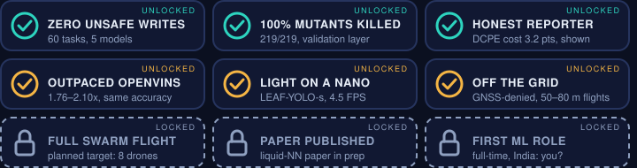

<h2 id="training"></h2>

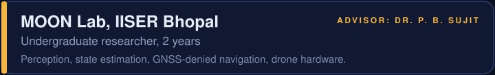

<h2 id="inventory"></h2>

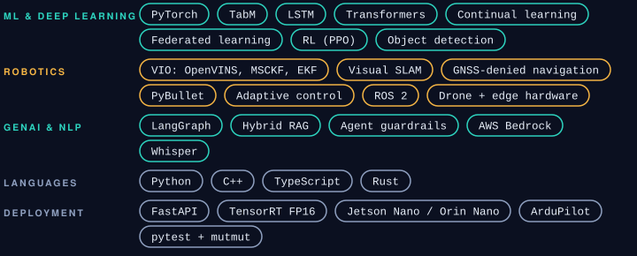

<a href="https://codolio.com/profile/PranjalUpadhyay">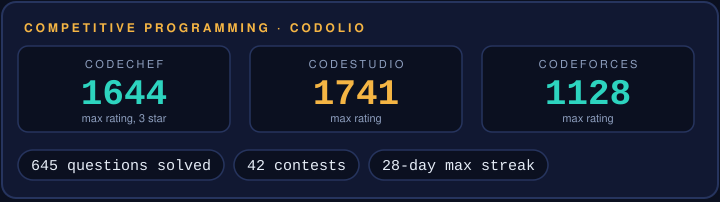</a>

<h2 id="contact"></h2>

Open to full-time ML Engineer roles in India. Message me on <a href="https://www.linkedin.com/in/pranjal-upadhyay7"><b>LinkedIn</b></a>.

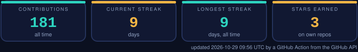

